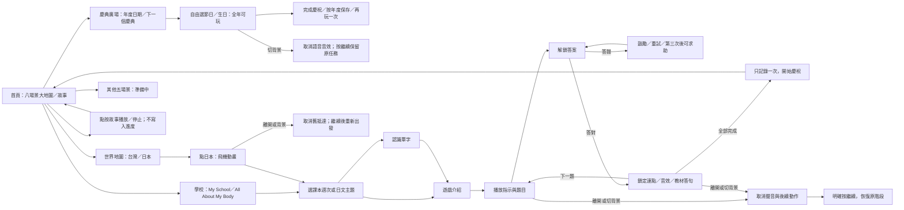

# panda-school 程式圖譜

20261019.v3醫院擴充：`hospital.js`的`HospitalVisit`／`HospitalSession`負責掛號、心情、工具、刷牙模型與耳鼻口辨識；`hospitalParts(catalog)`從正式教材派生標籤，`body-art.js`提供臉部圖。`app.js`的`hospital`路由接入返回、stop、背景、共享音訊與專心鎖，`hospital.css`提供響應版面；三張新內景見 [HOSPITAL.md](HOSPITAL.md)。狀態只在記憶體，不寫正式課程紀錄。

醫院短句語音：`hospital-voice.js`提供純狀態→短句對應，`HospitalSession.narrate`自動播放及取消佇列；`app.js`載入`content/hospital-audio.json`，透過LessonSpeech連接裝置中文或`assets/audio/hospital/`的22段WAV。`scripts/hospital-audio-manifest.mjs`從短句及正式教材派生映射，`scripts/generate-hospital-audio.ps1`只補醫院缺少錄音。

20261019.v2新增第二張地圖：`town-map.js` 統一六個地點、醫院科別與百貨店舖；由 `adventure-map.js` 的 `homeMapHTML`／`sceneHTML` 接入，`app.js` 新增 `town` 路由與返回動線。詳細範圍與素材來源見 [LIFE_TOWN.md](LIFE_TOWN.md)。

20261019.v2兒童樂園：`amusement-park.js` 包含獨立 `AmusementVisit` 模型及 `AmusementSession`，提供摩天輪、木馬、火車與煙火；`app.js` 的 `amusement` 路由接入stop、背景、音效與專心鎖；`amusement-park.css` 負責互動SVG／CSS與響應版面。詳見 [AMUSEMENT_PARK.md](AMUSEMENT_PARK.md)。

更新至20261019.v1，包含離線包、生活遊戲、家長工具與跨機Codex接手入口。早期功能區塊保留沿革；最上方圖為目前總覽。專案為靜態 HTML／CSS／JavaScript，沒有後端。

```mermaid
flowchart TD
  HTML["index.html · 版本與入口"] --> APP["app.js · 路由／設定／紀錄"]
  HTML --> CSS["style.css + storybook.css + body.css + adventure.css + festival.css + tablet.css · 響應版面"]
  HTML --> ICONS["site.webmanifest + assets/icons/ · 瀏覽器／iPad主畫面圖示"]
  APP --> MANIFEST["content/index.json · 課本清單"]
  MANIFEST --> SCHOOL["content/my-school.json · 第一本四週"]
  MANIFEST --> BODY["content/all-about-my-body.json · 第二本四週"]
  MANIFEST --> JAPANESE["content/japanese-school.json · 三主題／五欄單字"]
  APP --> ADVENTURE["adventure-map.js · 八個場景／台日韓飛行"]
  APP --> FESTIVALCAL["festival-calendar.js · 台北年度／農曆換算／慶典清單"]
  FESTIVALCAL --> FESTIVALDATA["content/festivals.json · 九個節日與生日"]
  APP --> FESTIVALGAME["festival-games.js · 七種玩法／九個入口"]
  FESTIVALGAME --> FESTIVALART["festival-art.js · 水彩角色圖框／互動物件"]
  APP --> FESTIVALVOICE["content/festival-audio.json · 27 段玩法語音"]
  APP --> FESTIVALSTORE["localStorage nickson-festivals · 年度/活動ID"]
  ADVENTURE --> MAPPAINT["assets/ · 小鎮／旅行／熊貓帽主角"]
  APP --> JAPANESEGAME["japanese-activities.js · 尋寶／便當／花園"]
  JAPANESEGAME --> JAART["japanese-art.js · 教學圖／正確顏色"]
  BANK --> JAART
  APP --> SHAPES["game.js · 形狀出題"]
  APP --> ACTIVITY["activities.js · 翻牌／角色／地圖"]
  APP --> BODYGAME["body-activities.js · 臉部／觸碰／機器人／感官"]
  ACTIVITY --> CAMPUS["campus.js · 校園路線與點選區"]
  APP --> BANK["question-bank.js · 家長教材預覽"]
  APP --> SPEECH["speech.js · 中英裝置語音／日文音量加強音檔／五級語速／備援"]
  APP --> SOUND["sounds.js · 答對音效／慶祝音樂"]
  APP --> CHARACTERS["characters.js · 主角與人物素材"]
  APP --> ART["illustrations.js · 教材圖像"]
  BODYGAME --> BODYART["body-art.js · 身體圖／機器人／感官物件"]
  ART --> BODYART
  APP --> STORYVIEW["school-story.js · 首頁故事與播放狀態"]
  APP --> STORY["content/school-stories.json · 河馬學校 Panda班故事"]
  APP --> TEXT["lesson-text.js · 句型代入"]
  BODYGAME --> TEXT
  BANK --> TEXT
  APP --> STORAGE["localStorage · book.id/unit.id 分開紀錄"]
  SPEECH --> WAV["assets/audio/ · 教材與故事備援"]
  CHARACTERS --> PNG["assets/characters/ · 去背人物"]
  APP --> LIFE["life-learning.js · 三題複習／洗澡／花園／餵魚／超市清單"]
  LIFE --> MANIFEST
  LIFE --> REVIEW["panda-school-extras · 日期／提示／1、3、7天間隔"]
  APP --> TABLE["table-game.js · 九件餐具／點選與拖曳"]
  APP --> PARK["sandpit + swing + slide + trampoline · 公園四遊戲"]
  APP --> HOUSE["home-activities + home-platformer · 洗澡／抱抱／電視闖關"]
  APP --> STUDIOS["dance-games + music-games · 舞蹈與音樂教室"]
  APP --> MEMORIES["memories.js + scene-memories.json · 分類相簿／放大／故事"]
  APP --> PARENTS["parent-tools.js · 備份／還原／休息提醒"]
  APP --> GATE["school-gate.js · 三下熊貓／本機PIN"]
  APP --> VOLUME["audio-controls + sounds + scene-life · 三個音量通道"]
  APP --> OFFLINE["offline.js · 下載／查詢／移除"]
  OFFLINE --> WORKER["sw.js · scope與版本快取／Range音檔"]
  WORKER --> PACK["offline-manifest.json · 靜態資源清單"]
  BUILD["scripts/release.mjs · 臺北日期版本"] --> HTML
  BUILD --> PACKBUILD["scripts/offline-manifest.mjs"]
  PACKBUILD --> PACK
  subgraph HANDOFF["另一台電腦與Codex"]
    START["START_HERE.md · 人與Codex入口"] --> RULES["AGENTS.md · 規則與授權邊界"]
    START --> STATUS["DEVELOPMENT_STATUS.md · 正式版與開發進度"]
    START --> GUIDE["DEVELOPMENT.md + SCRIPTS.md · 環境與指令"]
    RULES --> SKILLS[".agents/skills · 遊戲／教材素材／發布交接"]
    GUIDE --> CHECK["scripts/project-check.mjs · 跨機檢查與完整測試"]
  end
  CHECK -. "驗證" .-> APP

```

資料規則：題庫、單字卡、遊戲、語音模板均讀同一份課本 JSON；不另外維護家長用的詞彙清單。同名 Week 1 以課本 ID 隔離。故事播放不改變課本選擇或學習紀錄。

發布：`scripts/release.mjs` 更新 Asia/Taipei 日期版號與入口快取參數。只在家長通知發布時執行；原始主角照片保留於受 Git 排除的 `.local-assets/nickson-references/`。

驗證：`tests/` 透過 Node test 執行教材、音訊、出題、連點、取消恢復、紀錄與素材檢查；瀏覽器另做實際操作與尺寸檢查。

## 韓國 K-pop 舞蹈教室
- `adventure-map.js`：韓國入口，保留日本搭機與課程。
- `kpop.js`：歌曲選單、可見官方 YouTube IFrame Player、Nickson 自由律動。播放狀態控制動畫；切分頁或捲離影片會暫停，離開教室銷毀播放器。只在點歌曲後載入 IFrame API；沒有下載、拆出或另存歌曲音訊。
- `kpop.css`：繪本舞台、三種動作與手機／iPad 橫向版面。
- `tests/kpop.test.mjs`：播放、暫停、離開、載入失敗與過期回呼。

- K-pop 歌曲由 `KPOP_SONGS` 統一管理；歌曲卡片、標題、來源連結與 `KpopSession` 都使用所選歌曲。第二首為 SOYEON〈I’m gonna TOESA〉MBC MusicCore 舞台版（6MTxeUvX7VI），保留原 Queencard。

- 第三首 SEO EVE〈麻辣燙葫蘆〉（0zd6WZ1PLVs）預設 `step`。`DANCE_POSES` 定義六種自由律動，三個新增動畫為 step／groove／hop-turn；所有歌曲都可選，暫停仍保留所選動作。

- `CountryFlight` 共用台灣至日本／韓國飛行流程，目的地保存在飛行實例中；`startCountryFlight` 抵達日本開日文課、抵達韓國開 K-pop。背景中斷後保留同一目的地，舊名稱 `JapanFlight` 為相容匯出。

## 公園場景
- `adventure-map.js`：公園入口已開放；`sceneHTML(park)` 顯示 `parkSceneHTML`，沿用場景返回首頁流程。
- `assets/park-nickson-bench-watercolor.png`：融合坐木椅的 Nickson 與公園五種設施；提示詞保存於 `assets/park-scene.prompts.json`。
- `adventure.css`：公園圖與非互動設施列表，手機顯示完整圖片，iPad 橫向以可用高度縮放。
- 本階段僅場景欣賞，未新增遊戲、正式教材或學習紀錄。

## 家裡場景
- 首頁「家裡」入口顯示 `homeSceneHTML`，與公園共用完整圖片及響應式場景版面。
- `assets/home-family-watercolor.png`：融合新全家合照與客廳／餐廳／書桌區；提示詞保存於 `assets/home-scene.prompts.json`，原圖保留在本機參考庫。
- 本階段僅場景欣賞，尚未加入遊戲、教材或紀錄。

## 親子館場景
- 首頁「親子館」入口顯示 `familySceneHTML`，沿用公園與家裡的完整圖片及響應式版面。
- `assets/family-center-watercolor.png`：室內球池、跳跳床、溜滑梯、沙坑區、超市模擬區；完整提示詞保存於 `assets/family-center.prompts.json`。
- 本階段只做場景欣賞，設施名稱為非互動列表，未加入遊戲、教材或紀錄。

## 公園：我的回憶
- 公園頁面按「我的回憶」開啟 `park-memories` 相簿；返回公園保留既有場景，瀏覽照片不寫入學習紀錄。
- `memories.js`：完整照片、標題與描述、張數及上一張／下一張邊界控制。
- `content/park-memories.json`：相簿唯一內容清單；之後把照片放在 `assets/memories/park/` 並增加 photos 項目即可，無須更動頁面程式。
- 第一張 `swing-01.jpg` 為使用者提供 S__30834722_0.jpg 的原檔複本，未裁切或重繪。

## 沙坑尋寶
- 公園「沙坑尋寶」入口 → sandbox 頁面；每回合從 20 樣寶物中不重複抽出 3 樣藏在沙面下，挖出後拖進桶子或點選玩具再點桶子收藏。
- `sandpit.js`：獨立挖沙覆蓋模型、三個玩具的發現／收藏狀態、Canvas 沙面、Pointer Events 拖曳與點選；視窗縮放按當下畫面座標換算，不改寫課程學習紀錄。
- `sandpit.css`：公園背景、沙坑木框、小桶子、寶物收藏列與手機／iPad 版面。玩具與小桶子為原生 SVG，沙土與細沙為可互動 Canvas／CSS，沿用既有公園與主角素材，未另用圖片生成。
- 「幫我找一找」揭露一個玩具，提供鍵盤替代操作；「把沙鋪平，再玩一次」重設狀態與位置。
- 返回公園保留當次沙坑進度；切分頁只取消手勢及音效，回來可接著玩。`stop()` 銷毀舊指標監聽器與細沙特效，避免舊手勢重複收藏。
- 挖沙聲共用 GameSounds 與家長音效開關，找到／收藏／完成使用既有短音效。

- `TREASURES` 現有 20 樣，Fisher–Yates 洗牌後抽 3 樣；三個特別指定角色為皮卡丘、麵包超人、骨頭人，沿用原生 SVG 玩具畫法，未新增外部素材下載。

- 公園圖片的沙坑區加入原生 button 熱區（圖幅 x74%–99%、y51%–80%），與頂部按鈕共用 data-sandpit=open；位置隨圖片縮放，鍵盤也可聚焦開啟。其他設施暫未加入遊戲入口。

- `swing.js` / `swing.css`：公園秋千節奏模型、角色動畫、星星收集與生命週期；入口由 `app.js` 和公園圖熱區連接。

- `slide.js` / `slide.css`：公園滑梯貝茲路徑、三顆星檢查點、暫停清理與響應式介面；`tests/slide.test.mjs` 驗證停靠、收集及抵達流程。

- `trampoline.js` / `trampoline.css`：跳跳床蓄力與拋物線模型、逐步摘星、觸控／鍵盤操作、暫停及事件清理。

- `home-activities.js`：家裡洗澡／抱抱狀態、拖曳搓洗與中文語音、依 canonical catalog 選英文／日文課本。
- `home-platformer.js`：電視星光森林關卡、平台碰撞、雙段跳、收集與檢查點；`home-play.css` 共用家裡版面。
- `HOME_INTERACTIONS.md`：家裡第一版玩法、操作與新圖片／完整提示索引。

- `adventure-map.js` 的 `danceSceneHTML()`：大地圖舞蹈教室入口與擬真室內場景，圖片／提示來源見 `assets/DANCE_STUDIO_ASSETS.md`。

- `adventure-map.js` 的 `musicSceneHTML()`：大地圖音樂教室入口與樂器教室場景，素材／完整提示見 `assets/MUSIC_CLASSROOM_ASSETS.md`。

- `dance-games.js` / `dance-games.css`：舞蹈教室模仿、記憶及節奏三種玩法，接圖上練舞區；玩法與生命週期見 `DANCE_GAMES.md`。

- `music-games.js` / `music-games.css`：音樂教室自由彈奏、聽音辨樂器及引導旋律；`GameSounds.instrument()` 合成四種音色；玩法見 `MUSIC_GAMES.md`。

- `school-gate.js` / `school-gate.css`：熊貓三連點、專心上課鎖定、密碼解鎖與學習路由允許清單；學校雙語選書重用 `deskHTML`。

## 生活與載入優化
- optimized-images.js：保留原檔的場景WebP對照與尺寸，app.wrap、家庭重繪使用。
- life-learning.js／css：教材派生的生活複習回合、語言、提示、購物拖曳與操作生命週期。
- scene-life.js／css：場景裝飾、獨立環境音、停止清理及動態偏好。
- LIFE_OPTIMIZATION.md：素材尺寸、功能範圍與操作。

## 照片姿勢與分類相簿
- content/scene-memories.json＋park-memories.json：新舊照片合併，按場景分類。
- memories.js：memoryAlbum去重合併、memoryTabs分類及照片翻頁畫面；app保存相簿與返回入口。
- assets/characters/nickson-photo-usage.json、PHOTO_POSES_AND_MEMORIES.md：逐張用途與素材索引。

## 操作、動作與聲音細節
- audio-controls.js：三通道音量正規化與家長設定；speech/sounds/scene-life各自控制輸出。
- speech.js＋app.speak：相同播放共用；life-learning負責音效後答案及取消。
- slide/swing/trampoline：加速、推動能量、落地回彈；INTERACTION_POLISH.md記錄範圍。

### 複習與家長工具
- `parent-tools.js`：備份格式驗證、快照／還原、前景休息計時、家長設定表單。
- `life-learning.js`：教材派生的已學題池、加權不重複抽題、生活複習結果回呼。
- `memories.js`：縮圖、相簿文字覆寫；`app.js`：放大原生對話框及手勢、照片故事儲存、備份操作與提醒訊息。
- `school-gate.js`：預設PIN及驗證目前PIN後修改；PIN獨立於備份。
- `tests/parent-tools.test.mjs`、控制器新增整合測試；功能說明見`FAMILY_TOOLS.md`。

### 離線、生活與間隔複習
- `offline.js`：家長下載／查詢／移除介面。`sw.js`：scope與版本快取、完成標記、下載續傳、導航與音檔Range回應。
- `scripts/offline-manifest.mjs`／`offline-manifest.json`：離線檔案清單，release自動重新產生。
- `table-game.js`：九件餐具的狀態模型、SVG餐具、點選／拖曳與清理。
- `life-learning.js`：水池餵魚、超市清單、三題加權抽取及1／3／7天複習；`adventure-map.js`接圖上入口。
- `tests/offline-life.test.mjs`及controller整合涵蓋；說明見`OFFLINE_LIFE.md`。
