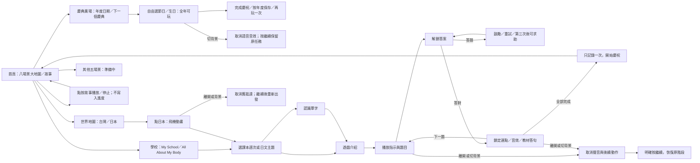

# panda-school 程式圖譜

此圖譜先於第二本遊戲實作建立，現已同步至完成的實作。專案為靜態 HTML／CSS／JavaScript，沒有後端。

```mermaid
flowchart TD
  HTML["index.html · 版本與入口"] --> APP["app.js · 路由／設定／紀錄"]
  HTML --> CSS["style.css + storybook.css + body.css + adventure.css + festival.css + tablet.css · 響應版面"]
  HTML --> ICONS["site.webmanifest + assets/icons/ · 瀏覽器／iPad主畫面圖示"]
  APP --> MANIFEST["content/index.json · 課本清單"]
  MANIFEST --> SCHOOL["content/my-school.json · 第一本四週"]
  MANIFEST --> BODY["content/all-about-my-body.json · 第二本四週"]
  MANIFEST --> JAPANESE["content/japanese-school.json · 三主題／五欄單字"]
  APP --> ADVENTURE["adventure-map.js · 八個場景／台日飛行"]
  APP --> FESTIVALCAL["festival-calendar.js · 台北年度／農曆換算／慶典清單"]
  FESTIVALCAL --> FESTIVALDATA["content/festivals.json · 九個節日與生日"]
  APP --> FESTIVALGAME["festival-games.js · 七種玩法／九個入口"]
  FESTIVALGAME --> FESTIVALART["festival-art.js · 水彩角色圖框／互動物件"]
  APP --> FESTIVALVOICE["content/festival-audio.json · 27 段玩法語音"]
  APP --> FESTIVALSTORE["localStorage nickson-festivals · 年度/活動ID"]
  ADVENTURE --> MAPPAINT["assets/ · 小鎮／旅行／熊貓帽主角"]
  APP --> JAPANESEGAME["japanese-activities.js · 尋寶／便當／花園"]
  JAPANESEGAME --> JAART["japanese-art.js · 教學圖／正確顏色"]
  BANK --> JAART
  APP --> SHAPES["game.js · 形狀出題"]
  APP --> ACTIVITY["activities.js · 翻牌／角色／地圖"]
  APP --> BODYGAME["body-activities.js · 臉部／觸碰／機器人／感官"]
  ACTIVITY --> CAMPUS["campus.js · 校園路線與點選區"]
  APP --> BANK["question-bank.js · 家長教材預覽"]
  APP --> SPEECH["speech.js · 中英裝置語音／日文音量加強音檔／五級語速／備援"]
  APP --> SOUND["sounds.js · 答對音效／慶祝音樂"]
  APP --> CHARACTERS["characters.js · 主角與人物素材"]
  APP --> ART["illustrations.js · 教材圖像"]
  BODYGAME --> BODYART["body-art.js · 身體圖／機器人／感官物件"]
  ART --> BODYART
  APP --> STORYVIEW["school-story.js · 首頁故事與播放狀態"]
  APP --> STORY["content/school-stories.json · 河馬學校 Panda班故事"]
  APP --> TEXT["lesson-text.js · 句型代入"]
  BODYGAME --> TEXT
  BANK --> TEXT
  APP --> STORAGE["localStorage · book.id/unit.id 分開紀錄"]
  SPEECH --> WAV["assets/audio/ · 教材與故事備援"]
  CHARACTERS --> PNG["assets/characters/ · 去背人物"]
```

資料規則：題庫、單字卡、遊戲、語音模板均讀同一份課本 JSON；不另外維護家長用的詞彙清單。同名 Week 1 以課本 ID 隔離。故事播放不改變課本選擇或學習紀錄。

發布：`scripts/release.mjs` 更新 Asia/Taipei 日期版號與入口快取參數。只在家長通知發布時執行；原始主角照片保留於受 Git 排除的 `.local-assets/nickson-references/`。

驗證：`tests/` 透過 Node test 執行教材、音訊、出題、連點、取消恢復、紀錄與素材檢查；瀏覽器另做實際操作與尺寸檢查。

## 韓國 K-pop 舞蹈教室
- `adventure-map.js`：韓國入口，保留日本搭機與課程。
- `kpop.js`：歌曲選單、可見官方 YouTube IFrame Player、Nickson 自由律動。播放狀態控制動畫；切分頁或捲離影片會暫停，離開教室銷毀播放器。只在點歌曲後載入 IFrame API；沒有下載、拆出或另存歌曲音訊。
- `kpop.css`：繪本舞台、三種動作與手機／iPad 橫向版面。
- `tests/kpop.test.mjs`：播放、暫停、離開、載入失敗與過期回呼。

- K-pop 歌曲由 `KPOP_SONGS` 統一管理；歌曲卡片、標題、來源連結與 `KpopSession` 都使用所選歌曲。第二首為 SOYEON〈I’m gonna TOESA〉MBC MusicCore 舞台版（6MTxeUvX7VI），保留原 Queencard。

- 第三首 SEO EVE〈麻辣燙葫蘆〉（0zd6WZ1PLVs）預設 `step`。`DANCE_POSES` 定義六種自由律動，三個新增動畫為 step／groove／hop-turn；所有歌曲都可選，暫停仍保留所選動作。

- `CountryFlight` 共用台灣至日本／韓國飛行流程，目的地保存在飛行實例中；`startCountryFlight` 抵達日本開日文課、抵達韓國開 K-pop。背景中斷後保留同一目的地，舊名稱 `JapanFlight` 為相容匯出。
